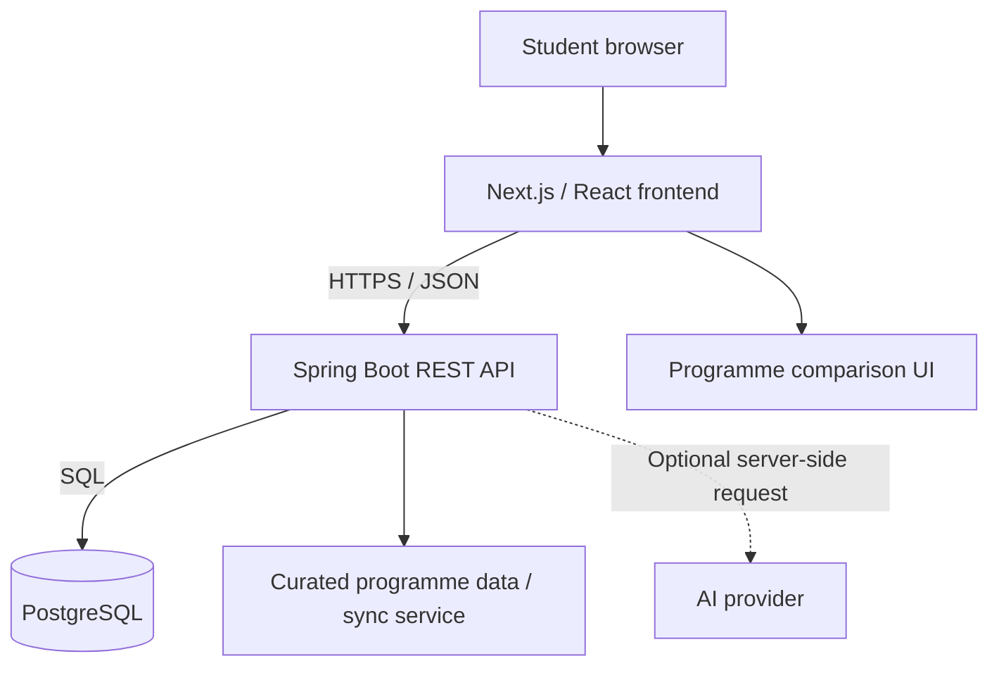

Pathway AI — High-Level Architecture Plan
Project: AI-Enhanced Team Hackathon
Status: Proposed architecture for the hackathon MVP, not an assertion that every component is currently deployed.
Goal: Deliver and demonstrate a usable university-programme discovery flow during a time-boxed team sprint.
1. Architecture overview
A simple three-tier web application separates the user interface, application/API logic, and persistent data. A genuine AI explanation feature is optional until an authenticated provider and successful calls can be verified.

Preferred technologies
Layer	Proposed technology	Responsibility
Frontend	Next.js + TypeScript	Pages, filtering UI, comparison, forms, responsive design
Backend	Java + Spring Boot	API endpoints, validation, access control, catalogue filtering
Database	PostgreSQL	Universities, programmes, accounts, preferences, shortlists
AI (optional)	Server-side API integration	Explain matching considerations without admissions guarantees
Testing	Unit tests, API tests, Playwright smoke tests	Validate critical user journeys
Hosting	Existing feasible deployment services	Publish a preview only after confirming it works
Version control	GitHub feature branches and PRs	Collaboration and review history

These are recommended choices that may be adjusted after inspecting the existing Pathway AI codebase and the team's available time.
2. Major components
Frontend
- Catalogue: browse and filter programmes (US-01, US-02, US-08).
- Details: source-aware information for one programme (US-03, US-10).
- Comparison: side-by-side view of selected programmes (US-04).
- Profile and shortlist: authenticated workflows when time allows (US-05, US-06).
- Matching explanation: clearly labeled rules-based or genuine AI output (US-07).
- Responsive UI: navigation, forms, feedback states, accessibility (US-09).
Backend
- Validates filter parameters and profile updates.
- Provides a consistent programme catalogue API.
- Manages shortlist and profile authorization.
- Queries the database with pagination and safe parameter handling.
- Optionally invokes AI services from the server only, avoiding leaked API keys.
Database
Uses the User, StudentProfile, University, Program, and SavedProgram entities defined in data_model.md.
3. Proposed API endpoints
Method	Path	Purpose	Access
GET	/api/v1/programs	List and filter programmes	Public
GET	/api/v1/programs/{id}	Retrieve programme details	Public
GET	/api/v1/universities	List institutions	Public
GET	/api/v1/account/profile	Read the student's profile	Authenticated
PUT	/api/v1/account/profile	Save or update preferences	Authenticated
GET	/api/v1/account/saved-programs	List saved programmes	Authenticated
POST	/api/v1/account/saved-programs	Save a programme	Authenticated
DELETE	/api/v1/account/saved-programs/{programId}	Remove a saved programme	Authenticated
POST	/api/v1/recommendations/explain	Optional suitability explanation	Authenticated or rate-limited

These are proposed contracts, not verified existing endpoints. Before implementation, inspect the current repository and reuse its real routes instead of duplicating them.
4. Main data flow
1. The browser requests the catalogue from the API.
2. The API applies validated filters and reads programme records from PostgreSQL.
3. The frontend renders results, clearly marking missing fields.
4. The visitor opens details and optionally selects programmes for side-by-side comparison.
5. If enabled, authenticated users save preferences and shortlists to PostgreSQL.
6. If genuinely configured, the backend generates an AI explanation grounded in supplied programme facts; otherwise show explicitly labeled non-AI guidance.
5. Data quality and security
- Data reliability: use a small curated dataset with explicit source URLs and last-verified dates; never imply mock data is official.
- Authentication: reuse existing authentication if it is functional; do not rebuild it unnecessarily during the sprint.
- Authorization: enforce access to private profiles and saved programmes on the server.
- Validation: reject malformed IDs and invalid budgets; return useful error responses.
- Secrets: keep database passwords and AI keys in server-side environment variables only.
- CORS and HTTPS: allow approved origins and serve the demo over HTTPS.
- AI safety: do not guarantee admission, invent tuition fees, or send unnecessary personal information to AI providers.
6. Testing strategy
Test	Minimum check
Catalogue	API returns valid records and handles empty data
Filtering	Multiple filters work; unknown tuition is not treated as zero
Details	Valid ID works and unknown ID returns not-found response
Comparison	Two programmes can be added, compared, and removed
Profile / shortlist (if built)	Save, reload, duplicate prevention, and access-control checks
Responsive	Core browsing flow works at desktop and mobile widths
AI (if built)	Real provider call succeeds; errors and provider unavailability handled honestly
Deployment	A fresh-browser smoke test loads the public demo

Record actual test executions and results in the final report. Do not mark a planned test as passed.
7. Hackathon implementation sequence
Phase A — Scope and environment: agree on MVP, assign actual team roles, inspect existing code, ensure development setup works.

Phase B — Core vertical slice: implement or verify catalogue → filters → programme detail → comparison using a small data set.

Phase C — Quality and optional functionality: add a persistent shortlist/profile only if time permits; AI explanation is a stretch goal unless already operational.

Phase D — Verification and demo: run smoke tests, deploy/verify a working URL, record limitations, prepare a short live demonstration and fallback screenshots.
Proposed role boundaries
Role	Work area
Team lead / integration	Scope, merge coordination, demo plan
Frontend contributor	Catalogue, comparison, responsive views
Backend contributor	API, filtering, persistence
Testing / documentation	Test cases, evidence, handover

Actual team members and assignments must be filled in after team agreement; do not fabricate collaborators.
8. Risks and mitigations
Risk	Mitigation
Too many features for a 24-hour sprint	Demonstrate a narrow but complete vertical slice
External API or AI-provider failure	Use verified, clearly labeled data and a non-AI fallback
Unverified programme facts	Show sources, verification dates, and explicit unknowns
Deployment trouble	Verify a hosted preview early; prepare local demo fallback
Merge conflicts and duplicated work	Assign owners, use small PRs, test before merging
Team availability or rules differ	Confirm actual roster and hackathon policy before claiming completion

9. Deliverables
For this planning task:
- user_stories.md — user-facing requirements and acceptance criteria.
- data_model.md — logical entities, fields, relationships, and business rules.
- architecture_plan.md — components, data flow, endpoints, security, testing, and sprint scope.
Later hackathon tasks may require actual code, a working deployment, team evidence, and reflection. Those are not claimed as completed by these planning documents.
