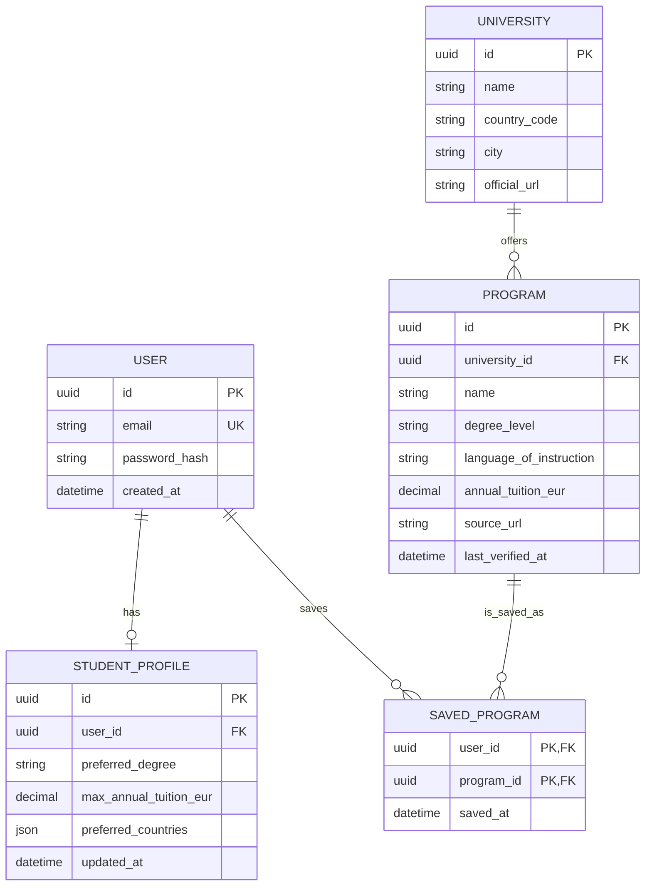

Pathway AI — Data Model
Project: AI-Enhanced Team Hackathon
Status: Proposed logical data model; actual database schema must be checked against the codebase before claiming implementation.
Storage: PostgreSQL is a suitable choice for persistent MVP data.
Entities
The MVP defines five entities, exceeding the assignment's requirement of at least three.
1. User
Represents an authenticated student account.
Field	Type	Constraint / purpose
id	UUID	Primary key
email	VARCHAR(255)	Unique, required; normalized for lookup
password_hash	VARCHAR(255)	Nullable for external-login accounts; never plaintext
created_at	TIMESTAMPTZ	Required

Notes: Authentication may be delegated to an existing provider. This is a logical representation, not a mandate to rebuild authentication for the hackathon.
2. StudentProfile
Holds a student's search preferences.
Field	Type	Constraint / purpose
id	UUID	Primary key
user_id	UUID	Foreign key → User.id; unique, required
preferred_degree	VARCHAR(50)	E.g., MASTER
max_annual_tuition_eur	NUMERIC(10,2)	Nullable; if present, nonnegative
preferred_countries	JSONB	Array of country codes; optional
updated_at	TIMESTAMPTZ	Required

Relationship: Each user may have zero or one student profile; each profile belongs to exactly one user.
3. University
Represents a higher-education institution.
Field	Type	Constraint / purpose
id	UUID	Primary key
name	VARCHAR(255)	Required
country_code	CHAR(2)	Required ISO-style country code
city	VARCHAR(120)	Nullable
official_url	TEXT	Nullable; official institution site

Relationship: One university offers many programmes.
4. Program
Represents an individual degree programme.
Field	Type	Constraint / purpose
id	UUID	Primary key
university_id	UUID	Foreign key → University.id; required
name	VARCHAR(255)	Required
degree_level	VARCHAR(50)	Required; e.g., BACHELOR, MASTER
language_of_instruction	VARCHAR(80)	Nullable
annual_tuition_eur	NUMERIC(10,2)	Nullable; nonnegative when present
source_url	TEXT	Nullable; verified programme page
last_verified_at	TIMESTAMPTZ	Nullable; when source facts were checked

Notes: A NULL tuition means unknown, not zero/free. The original source currency, fee conditions, and study-year applicability should be retained in a larger production schema; the simplified EUR field is an MVP assumption and must not be used for real admissions advice without verification.
5. SavedProgram
Join entity for a user's shortlist.
Field	Type	Constraint / purpose
user_id	UUID	Foreign key → User.id
program_id	UUID	Foreign key → Program.id
saved_at	TIMESTAMPTZ	Required

Constraints: Composite primary key (user_id, program_id) prevents duplicates. The API checks authorization so one user cannot view or alter another user's saved programmes.
Relationship diagram

Business rules
1. A programme belongs to one university; a university may have zero or more programmes.
2. A student can save the same programme only once.
3. Only the account owner can edit a profile or shortlist.
4. Filters do not treat unknown tuition as free; queries must handle NULL explicitly.
5. A programme's official/source link and verification date are optional, but missing values must be visible as unverified.
6. No sensitive profile information, credentials, or AI provider keys are returned to public clients.
Example API-facing data (illustrative, not an actual university record)
{
  "id": "11111111-1111-4111-8111-111111111111",
  "name": "Example MSc in Computer Science",
  "degreeLevel": "MASTER",
  "university": { "name": "Example University", "countryCode": "PL" },
  "annualTuitionEur": null,
  "languageOfInstruction": "English",
  "sourceUrl": null,
  "lastVerifiedAt": null
}
The placeholder record above must not be presented as a genuine programme.
Scope boundaries
For the hackathon, programme comparison can be computed from selected Program records without an additional table. Recommendation explanations can likewise be derived on demand; a persistent AI conversation or recommendation entity is unnecessary for the minimum viable demonstration.
