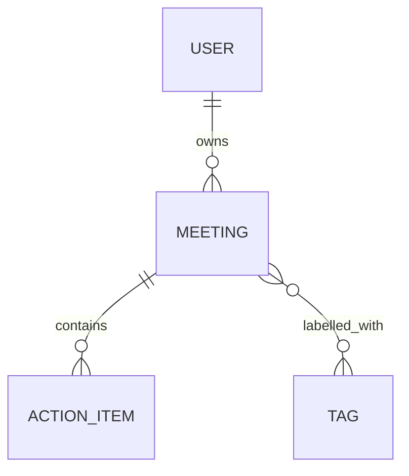

# Data Model – AI Meeting Notes Assistant

## Entities

### 1. User
| Field         | Type      | Notes                 |
|---------------|-----------|-----------------------|
| id            | UUID (PK) |                       |
| email         | string    | unique                |
| name          | string    |                       |
| password_hash | string    |                       |
| created_at    | timestamp |                       |

### 2. Meeting
| Field        | Type      | Notes                      |
|--------------|-----------|----------------------------|
| id           | UUID (PK) |                            |
| user_id      | UUID (FK) | → User.id                  |
| title        | string    |                            |
| transcript   | text      | raw input                  |
| summary      | text      | AI-generated               |
| meeting_date | date      |                            |
| created_at   | timestamp |                            |

### 3. ActionItem
| Field      | Type      | Notes                          |
|------------|-----------|--------------------------------|
| id         | UUID (PK) |                                |
| meeting_id | UUID (FK) | → Meeting.id                   |
| title      | string    | extracted by AI, editable      |
| owner      | string    | name mentioned in transcript   |
| due_date   | date      | nullable                       |
| status     | enum      | `open` / `done`                |
| created_at | timestamp |                                |

### 4. Tag (optional, post-MVP)
| Field | Type      | Notes  |
|-------|-----------|--------|
| id    | UUID (PK) |        |
| name  | string    | unique |

`MeetingTag` join table: `meeting_id`, `tag_id`.

## Relationships
- User 1 — * Meeting
- Meeting 1 — * ActionItem
- Meeting * — * Tag (via MeetingTag)

## ER Diagram

