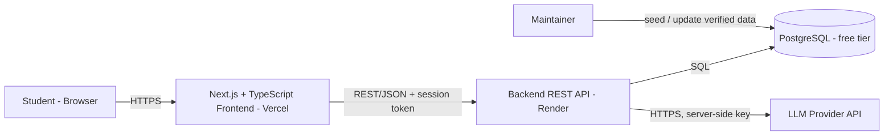
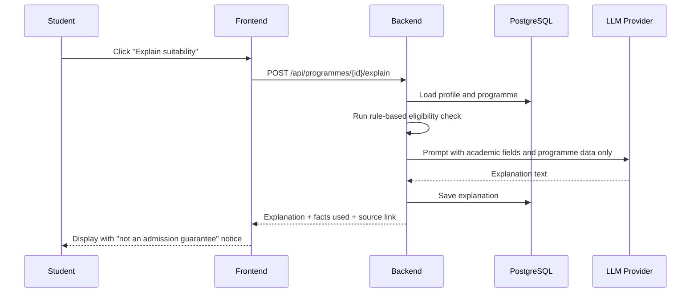

# Architecture - Pathway AI MVP

## Overview

A three-tier web application: a Next.js frontend, a REST API backend, and a PostgreSQL database. The backend is the only component that talks to the LLM provider, so the API key never reaches the browser.

## System diagram

## Components

| Component | Technology | Responsibility |
|---|---|---|
| Frontend | Next.js, TypeScript, Tailwind CSS | Profile forms, programme list and filters, comparison view, shortlist, AI explanation display |
| Backend API | Spring Boot (Java) or Node.js/Express | Authentication, profile CRUD, programme search and filter, eligibility check, shortlist, AI explanation orchestration |
| Database | PostgreSQL | Users, profiles, universities, programmes, shortlist entries, saved explanations |
| LLM provider | One hosted LLM API | Generates the suitability explanation from structured input |
| Hosting | Vercel (frontend), Render (backend), free-tier PostgreSQL | Free-tier deployment |

## Main API endpoints

| Method | Path | Purpose |
|---|---|---|
| POST | `/api/auth/register`, `/api/auth/login` | Account creation and login |
| GET / PUT / DELETE | `/api/profile` | Read, update, or delete the student profile |
| GET | `/api/programmes` | Search and filter (country, tuition, degree, language, eligibility) |
| GET | `/api/programmes/{id}` | Programme detail |
| GET / POST / DELETE | `/api/shortlist` | Manage the shortlist |
| GET | `/api/compare?ids=1,2,3` | Side-by-side comparison data |
| POST | `/api/programmes/{id}/explain` | AI suitability explanation |

## Key flow: AI suitability explanation

## Design decisions

- **Rule-based eligibility, AI for explanation.** Eligibility ("meets / may not meet / unknown") is computed by deterministic code, so it is testable and cannot be invented by the model. The LLM only explains the result.
- **Server-side LLM calls.** Keeps the API key secret and lets the backend limit what data is sent (no name or email).
- **Source tracking.** Every programme carries a source URL and a last-verified date.
- **Graceful degradation.** If the LLM fails, filters, comparison, and shortlist still work.

## Security and privacy

- HTTPS only; passwords hashed; secrets in environment variables.
- Minimal personal data; users can delete their account and data.
- Input validation on all endpoints; rate limiting on the explain endpoint.

## Out of scope for the MVP

Payments, application tracking, scraping pipelines, native mobile apps, and third-party application-portal integrations.
