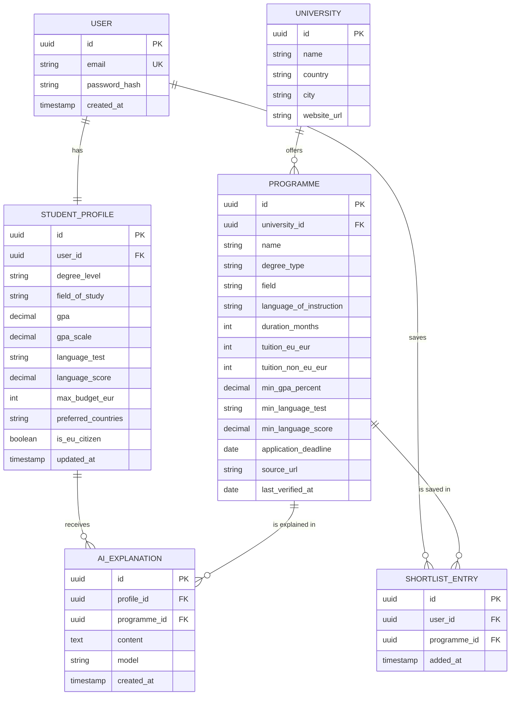

# Data Model - Pathway AI MVP

PostgreSQL. Six entities.

## Entity relationship diagram

## Entities

### User
Account for authentication. Holds only an email and a password hash.

### StudentProfile
Academic profile and preferences used for filtering and explanations. One per user. Deleted with the user.

### University
Institution reference data: name, country, city, website.

### Programme
A master's programme offered by a university. Requirement and tuition fields are nullable; **null means "unknown"**, never zero. `source_url` and `last_verified_at` are required so users can verify facts.

### ShortlistEntry
Join between a user and a programme. Unique on `(user_id, programme_id)`.

### AIExplanation
A saved suitability explanation for a profile and programme pair, with the model name and timestamp, so it can be shown again without another LLM call.

## Relationships

- User 1 - 1 StudentProfile.
- University 1 - N Programme.
- User N - M Programme through ShortlistEntry.
- StudentProfile N - M Programme through AIExplanation.

## Constraints and indexes

- `User.email` unique; `ShortlistEntry(user_id, programme_id)` unique.
- Indexes on `Programme(degree_type, tuition_non_eu_eur)` and `University(country)` for filtering.
- Foreign keys use `ON DELETE CASCADE` for user-owned data so account deletion removes the profile, shortlist, and explanations.
- GPA values are normalised to a percentage for comparison against `min_gpa_percent`.
